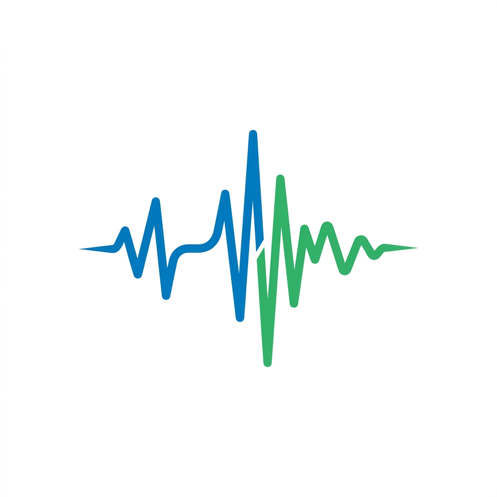
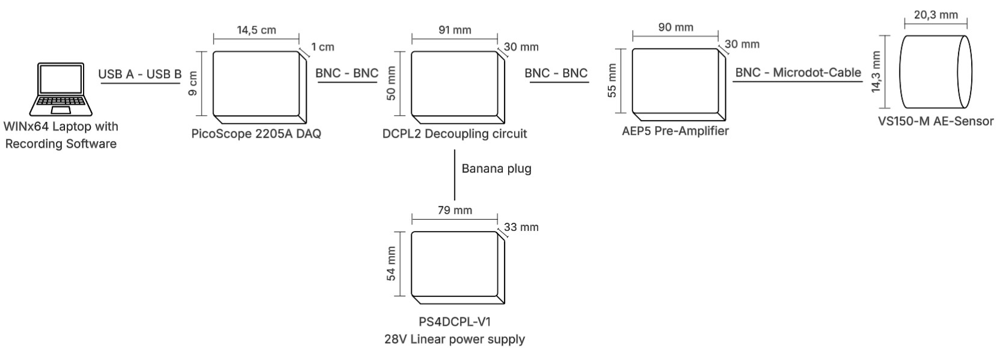
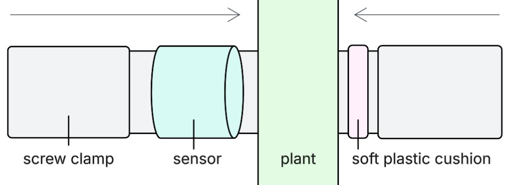

<div align="center">
  
  <h1>🔬 AE-Lab (Acoustic Emission Laboratory)</h1>
  <p><strong>Acoustic Emission Analysis, Real-Time Acquisition & Machine Learning Platform for Plant Cavitation Monitoring</strong></p>

  [](https://www.python.org/)
  [](https://pytorch.org/)
  [](https://streamlit.io/)
  [](https://scikit-learn.org/)
  [](LICENSE)
</div>

---

## 📑 Table of Contents
- [📖 Overview](#-overview)
- [✨ Key Features](#-key-features)
- [📊 Benchmark Results (Classical ML vs. Deep Learning)](#-benchmark-results-classical-ml-vs-deep-learning)
- [🛠️ Technology Stack](#️-technology-stack)
- [🕹️ Hardware Setup](#️-hardware-setup)
- [🚀 Installation & Setup](#-installation--setup)
- [🎮 Usage Guide](#-usage-guide)
- [📂 Project Architecture](#-project-architecture)
- [🔬 Scientific Reproducibility](#-scientific-reproducibility)

---

## 📖 Overview

**AE-Lab** is an end-to-end laboratory and software platform designed to record, process, and classify Acoustic Emission (AE) events in plants. It specifically targets **xylem cavitation phenomena**—microscopic air bubble collapse events within vascular plant tissues under drought or mechanical stress.

By interfacing directly with high-frequency oscilloscope hardware (PicoScope), the platform captures ultrasonic transients at sampling rates up to **50 MS/s**. The raw signals undergo feature engineering and are benchmarked across both **Classical Machine Learning** (Random Forest, XGBoost, Support Vector Machines) and **Deep Learning** pipelines (1D Waveform Convolutional Neural Networks and 2D Continuous Wavelet Transform networks).

---

## ✨ Key Features

### 📡 1. Real-Time Data Collection
* **PicoScope Hardware Interface:** Native integration via `picosdk` for high-frequency oscilloscope data acquisition.
* **Live Oscilloscope & FFT Dashboard:** A Streamlit-based interface visualizing raw waveforms ($V(t)$) and real-time Fast Fourier Transform (FFT) spectra.
* **Automated Triggering:** Configurable voltage triggers capture discrete transient bursts with pre-trigger buffering to avoid clipping event shock fronts.

### 🧠 2. Supervised Machine Learning Pipeline
* **Noise vs. Cavitation Detection:** Classifies genuine cavitation events against ambient acoustic noise and electrical transients (achieving $>99.5\%$ accuracy and $100\%$ signal recall).
* **Plant Species Classification:** Leave-One-Plant-Out (LOPO) cross-validation assessing species-specific acoustic traits across unseen specimens (*Capsicum annuum*, *Helianthus annuus*, *Solanum lycopersicum*).
* **Stress Type Diagnosis:** Distinguishes mechanical cutting (xylem severance) from hydraulic drought stress across grouped plant cross-validation folds.

### ⚡ 3. End-to-End Deep Learning Architectures
* **1D-CNN on Raw Waveforms:** Processes decimated raw voltage series ($3{,}125$ samples at $12.5\text{ MS/s}$) with hierarchical temporal convolutional kernels, bypassing manual feature extraction.
* **2D-CNN on CWT Scalograms:** Converts waveforms into time-frequency power scalograms via analytic complex Morlet wavelets ($32\text{ frequency scales} \times 128\text{ time steps}$) to capture non-stationary resonance decay.
* **Unified Benchmark Suite:** Leakage-free, multi-seed cross-validation comparing classical and deep architectures on strictly identical sample partitions.

### 🗺️ 4. Semi-Supervised Discovery & Cluster Analytics
* **Interactive 3D UMAP / t-SNE Projections:** High-dimensional acoustic feature space exploration in interactive 3D WebGL plots.
* **Anomaly Detection:** Identifies outliers and mislabeled events using Isolation Forests and Gaussian Mixture Models.
* **Visual Lasso Relabeling:** Rapid manual relabeling of acoustic clusters directly in the UI to clean ground-truth datasets.

---

## 📊 Benchmark Results (Classical ML vs. Deep Learning)

All models are evaluated under strict grouped validation protocols without data leakage:

| Task | Classical ML Baseline | 1D Waveform CNN | 2D CWT Scalogram CNN | Key Physical Finding |
| :--- | :--- | :--- | :--- | :--- |
| **1. Noise vs. Cavitation**<br>*(4,855 hold-out events)* | **99.53% Acc** / **0.9787 Macro F1**<br>*(Random Forest, 10 features)* | **99.41% Acc** / **0.9738 Macro F1**<br>*(99.4% Signal Recall, 0.976 F2)* | **90.34% Acc** / **0.8027 Macro F1**<br>*(90.7% Signal Recall)* | **Full Success:** Raw 1D-CNN completely eliminates manual feature engineering for noise screening. |
| **2. Plant Species (LOPO)**<br>*(13 plants, 575 test events)* | **15.30% Acc** / **0.1452 Macro F1**<br>*(XGBoost + UMAP, 65 features)* | **17.80% Acc** / **0.1966 Macro F1**<br>*(32.25% Mean Plant Acc)* | **19.94% Acc** / **0.1802 Macro F1**<br>*(32.49% Mean Plant Acc)* | **Specimen Bottleneck:** Handcrafted & deep models stall below chance due to plant acoustic transfer function. |
| **3. Stress Type (196 samples)**<br>*(98 Drought vs. 98 Cut)* | **44.39% Acc** / **0.4406 Macro F1**<br>*(SVM RBF, 62 features)* | **43.88% Acc** / **0.4303 Macro F1**<br>*(Raw 1D series)* | **53.57% Acc** / **0.5288 Macro F1**<br>*(Morlet Scalogram)* | **Acoustic Overlap:** Single burst transients overlap physically; contextual environmental data required. |
| **3. Stress Type (502 samples)**<br>*(251 Drought vs. 251 Cut)* | **56.77% Acc** / **0.5674 Macro F1**<br>*(SVM RBF, 62 features)* | **33.27% Acc** / **0.3307 Macro F1**<br>*(Raw 1D series)* | **59.83% Acc** / **0.5807 Macro F1**<br>*(Morlet Scalogram)* | **CWT Advantage:** Time-frequency representation extracts subtle fracture dynamics on larger data cohorts. |

Detailed metrics, derivations, and confusion matrices are documented in [results/deep_learning/model_comparison_summary.md](results/deep_learning/model_comparison_summary.md).

---

## 🛠️ Technology Stack

| Category | Components & Libraries |
| :--- | :--- |
| **Deep Learning** | PyTorch (`torch`, `torch.nn`), PyWavelets (`pywt`) |
| **Classical ML** | Scikit-Learn, Imbalanced-Learn (SMOTE), XGBoost, Optuna |
| **Unsupervised ML** | UMAP-Learn, HDBSCAN |
| **Web Dashboard** | Streamlit, Plotly Express, Plotly Graph Objects |
| **Hardware Acquisition** | PicoSDK (Pico Technology 5000-series Oscilloscopes) |
| **Data Processing** | Pandas, NumPy, SciPy, Pillow |
| **Database** | SQLite3 (`metadata.db`) |

---

## 🕹️ Hardware Setup

The physical setup consists of a piezoelectric acoustic emission sensor (e.g., Pico-HF) coupled to the plant stem, interfaced through preamplifiers into a PicoScope digital oscilloscope.

<div align="center">
  
  <p><em>Figure 1: Laboratory hardware acquisition setup and sensor dimensions.</em></p>
</div>

To ensure acoustic contact without damaging delicate vascular tissues, the sensor is clamped using acoustic couplant gel and buffered with a compliant backing on the opposing stem side:

<div align="center">
  
  <p><em>Figure 2: Piezoelectric acoustic emission sensor mounted to a plant stem.</em></p>
</div>

---

## 🚀 Installation & Setup

### 1. Prerequisites
- **Python 3.10+** (64-bit recommended)
- **PicoScope Drivers:** Install the official Pico Technology drivers corresponding to your oscilloscope hardware (Windows / Linux).

### 2. Repository Setup
```bash
# Clone repository
git clone https://github.com/ETCE-LAB/AE-Lab.git
cd AE-Lab

# Create and activate virtual environment
python -m venv venv
# Windows:
venv\Scripts\activate
# Linux/macOS:
source venv/bin/activate

# Install dependencies
pip install -r requirements.txt
```

---

## 🎮 Usage Guide

### 1. Live Acquisition Dashboard
Launch the interactive Streamlit data acquisition interface:
```bash
streamlit run data_collection/data_collection.py
```
*Allows connecting to the PicoScope, configuring trigger thresholds, and monitoring real-time waveforms and FFT spectrograms.*

### 2. Analysis & Semi-Supervised Discovery Dashboard
Launch the data analysis and exploratory machine learning suite:
```bash
streamlit run data_analysis/data_analysis.py
```
*Visualizes recordings, evaluates trained models on test sets, and explores 3D UMAP feature projections with interactive lasso relabeling.*

### 3. Model Training & Benchmarking

#### Classical Machine Learning Models:
```bash
# Train noise rejection Random Forest
python model_training/train_and_save_noise_model.py

# Train plant species classifier (Leave-One-Plant-Out)
python model_training/train_and_save_plant_model.py

# Train stress diagnosis SVM
python model_training/train_and_save_stress_model.py
```

#### Unified Deep Learning Benchmark:
```bash
# Run the complete, leakage-free benchmark across all tasks:
python model_training/deep_learning/unified_benchmark.py all --seeds 3

# Or benchmark specific tasks individually:
python model_training/deep_learning/unified_benchmark.py noise
python model_training/deep_learning/unified_benchmark.py plant
python model_training/deep_learning/unified_benchmark.py stress

# Generate Markdown reports and summary comparison tables:
python model_training/deep_learning/compare_models.py
```

---

## 📂 Project Architecture

```text
AE-Lab/
├── .documentation/              # Visual assets, hardware setup diagrams, and schematics
├── data_collection/             # Real-time PicoScope interface, streamer & acquisition UI
│   ├── data_collection.py       # Streamlit acquisition dashboard
│   ├── picoscope_measure.py     # Hardware controller & oscilloscope trigger loops
│   └── feature_cache.csv        # Pre-extracted acoustic feature cache
├── data_analysis/               # Analysis dashboards, unsupervised clustering & lasso relabeling
│   ├── data_analysis.py         # Main analysis dashboard
│   └── unsupervised_pipeline.py # 3D UMAP & clustering engine
├── helper_scripts/              # Feature extraction, audio transform & SQLite sync utilities
├── model_training/              # Supervised ML & Deep Learning training pipelines
│   ├── train_and_save_noise_model.py   # Classical Noise classifier (Random Forest)
│   ├── train_and_save_plant_model.py   # Classical Plant classifier (XGBoost LOPO)
│   ├── train_and_save_stress_model.py  # Classical Stress classifier (SVM RBF)
│   └── deep_learning/           # End-to-end Deep Learning benchmark suite
│       ├── dataset.py           # Waveform decimation, Morlet CWT generator & PyTorch Datasets
│       ├── models.py            # 1D-CNN (Waveform) & 2D-CNN (CWT Scalogram) architectures
│       ├── unified_benchmark.py # Synchronized, leakage-free benchmark runner
│       ├── compare_models.py    # Automated report & markdown table generator
│       └── plot_comparison.py   # Interactive Plotly visual benchmark comparisons
├── models/                      # Saved models, encoders, scalers, and JSON metadata
│   ├── *.pkl                    # Classical models, scalers, and label encoders
│   └── deep_learning/           # Trained PyTorch weights (*.pt) & benchmark metric JSONs
├── results/                     # HTML interactive charts, cluster outputs & evaluations
│   └── deep_learning/           # Comprehensive thesis reports & comparison summaries
├── .gitignore                   # Git exclusion rules (ignores raw wave data, large caches, scratch)
├── metadata.db                  # SQLite database tracking recordings, labels, and metadata
└── requirements.txt             # Project dependencies
```

---

## 🔬 Scientific Reproducibility

This repository contains the experimental framework and models developed in the Bachelor thesis:
> **"Machine Learning-Based Detection and Classification of Plant Xylem Cavitation Events Using Acoustic Emission Sensors"**  
> *Author:* Marius Peter  
> *Institution:* Institute for Software and Systems Engineering, Clausthal University of Technology  